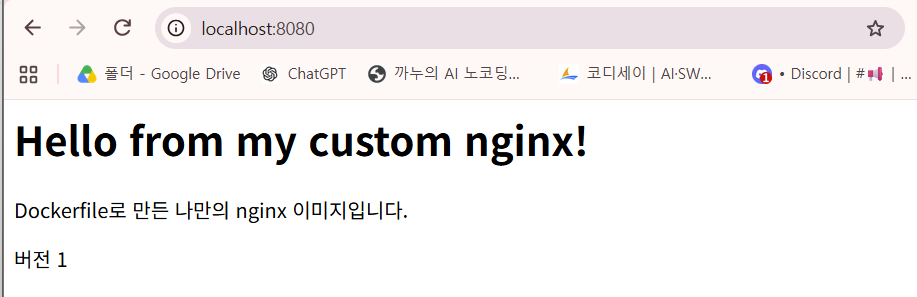
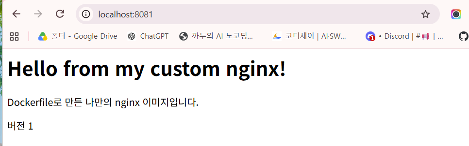

# 내 컴퓨터에 개발자용 작업실 꾸미기

## 1. 개요

경남 코디세이 AI 올인원 1기 입학연수 미션1 「내 컴퓨터에 개발자용 작업실 꾸미기」의 수행 기록입니다.

이 미션은 로컬(내 컴퓨터)에 터미널, Docker, Git으로 개발 환경(작업실)을 만들고, 그 과정을 명령어와 결과로 기록해 **누구나 같은 방법으로 실행하고 확인할 수 있게** 하는 것입니다.

- Git 사용자 정보를 설정하고, GitHub 저장소와 VSCode를 연결한다.
- 터미널로 작업 폴더와 파일을 만들고, 복사, 이동, 이름 변경, 삭제한다.
- 파일과 폴더의 권한을 확인하고, 바꾸기 전과 후를 비교한다.
- Docker 설치를 점검하고, 이미지와 컨테이너를 실행·중지·확인한다.
- Dockerfile로 나만의 웹 서버 이미지를 만들고, 포트 매핑으로 브라우저에서 접속한다.
- 바인드 마운트로 파일 수정이 바로 반영되는지(변경 반영), 볼륨으로 컨테이너를 지워도 데이터가 남는지(데이터 영속성) 확인한다.

## 2. 실행 환경

- OS: Windows 11 Home 25H2 (빌드 26200)
- CPU / 메모리: Intel i7 (x86_64) / 16GB
- 리눅스 환경: WSL 2 + Ubuntu
- 터미널: Windows PowerShell 5.1, Ubuntu bash (VSCode 통합 터미널)
- Git: 2.53.0
- Docker: Docker Desktop (WSL 2 기반), Docker 29.9.2
- 편집기: VSCode 1.145.2 (WSL 확장으로 Ubuntu 연결)

## 3. 수행 체크리스트

- [x] Git 사용자 정보·기본 브랜치 설정, GitHub 저장소 연결
- [x] VSCode에서 WSL(Ubuntu)로 작업 폴더 열기, GitHub 로그인
- [x] 터미널: 위치 확인, 폴더·파일 만들기, 복사, 이동, 이름 변경, 삭제
- [x] 권한: 파일·폴더 권한 변경 전/후 비교
- [x] Docker 설치·엔진 점검
- [x] 이미지·컨테이너 실행, 목록, 로그, 리소스 확인, 중지
- [x] hello-world 실행, ubuntu 컨테이너 attach/exec 비교
- [x] Dockerfile로 커스텀 이미지 빌드
- [x] 포트 매핑 접속 확인 (2회)
- [ ] 바인드 마운트: 파일 수정 전/후 확인
- [ ] 볼륨: 컨테이너 삭제 후 데이터 유지 확인
- [x] 트러블슈팅 2건 이상 기록

## 4. 수행 기록

### 구역 1 - 준비 (Git, GitHub, VSCode)

1. Git 설치 확인

```
$ git --version
git version 2.53.0
```

2. Git 사용자 정보, 기본 브랜치 설정 확인

```
$ git config --list
user.email=302385656+jjin1990@users.noreply.github.com
user.name=jjin1990
init.defaultbranch=main
core.repositoryformatversion=0
core.filemode=true
core.bare=false
core.logallrefupdates=true
remote.origin.url=https://github.com/jjin1990/mission1.git
remote.origin.fetch=+refs/heads/*:refs/remotes/origin/*
branch.main.remote=origin
branch.main.merge=refs/heads/main
```

3. GitHub 저장소 연결 확인

```
$ git remote -v
origin  https://github.com/jjin1990/mission1.git (fetch)
origin  https://github.com/jjin1990/mission1.git (push)
```

4. 커밋, 푸시 기록 확인

```
$ git log --oneline
46e6eb8 (HEAD -> main, origin/main) README 목차, 개요, 실행 환경, 수행 체크리스트 추가
56a1d94 구역 2 터미널 조작 본문 기록
0839dd4 README 제목 추가
```

### 구역 2 - 터미널 조작

1. 현재 위치 확인

```
$ pwd
/home/shbm1/codyssey/mission1
```

2. 연습용 폴더 만들기

```
$ mkdir practice
$ ls -al
total 20
drwxr-xr-x 4 shbm1 shbm1 4096 Nov  8 20:22 .
drwxr-xr-x 3 shbm1 shbm1 4096 Nov  8 19:23 ..
drwxr-xr-x 7 shbm1 shbm1 4096 Nov  8 20:13 .git
-rw-r--r-- 1 shbm1 shbm1   51 Nov  8 20:05 README.md
drwxr-xr-x 2 shbm1 shbm1 4096 Nov  8 20:22 practice
```

3. 빈 파일 만들기

```
$ touch practice/memo.txt
$ ls -al
total 20
drwxr-xr-x 4 shbm1 shbm1 4096 Nov  8 20:22 .
drwxr-xr-x 3 shbm1 shbm1 4096 Nov  8 19:23 ..
drwxr-xr-x 7 shbm1 shbm1 4096 Nov  8 20:13 .git
-rw-r--r-- 1 shbm1 shbm1   51 Nov  8 20:05 README.md
drwxr-xr-x 2 shbm1 shbm1 4096 Nov  8 20:25 practice
$ la -al practice
total 8
drwxr-xr-x 2 shbm1 shbm1 4096 Nov  8 20:25 .
drwxr-xr-x 4 shbm1 shbm1 4096 Nov  8 20:22 ..
-rw-r--r-- 1 shbm1 shbm1    0 Nov  8 20:25 memo.txt
```

4. practice 폴더로 이동

```
$ cd practice
$ pwd
/home/shbm1/codyssey/mission1/practice
```

5. 파일에 한 줄 쓰기 + 내용 확인

```
$ echo 안녕 > memo.txt
$ cat memo.txt
안녕
```

6. 파일 복사

```
$ cp memo.txt memo_copy.txt
$ ls -al
total 16
drwxr-xr-x 2 shbm1 shbm1 4096 Nov  8 20:38 .
drwxr-xr-x 4 shbm1 shbm1 4096 Nov  8 20:22 ..
-rw-r--r-- 1 shbm1 shbm1    7 Nov  8 20:34 memo.txt
-rw-r--r-- 1 shbm1 shbm1    7 Nov  8 20:38 memo_copy.txt
$ cat memo_copy.txt
안녕
```

7. 파일 이름 변경

```
$ mv memo_copy.txt memo_renamed.txt
$ ls -al
total 16
drwxr-xr-x 2 shbm1 shbm1 4096 Nov  8 20:41 .
drwxr-xr-x 4 shbm1 shbm1 4096 Nov  8 20:22 ..
-rw-r--r-- 1 shbm1 shbm1    7 Nov  8 20:34 memo.txt
-rw-r--r-- 1 shbm1 shbm1    7 Nov  8 20:38 memo_renamed.txt
```

8. 다른 폴더로 이동

```
$ mkdir backup
$ mv memo_renamed.txt backup/
$ ls -al
total 16
drwxr-xr-x 3 shbm1 shbm1 4096 Nov  8 20:45 .
drwxr-xr-x 4 shbm1 shbm1 4096 Nov  8 20:22 ..
drwxr-xr-x 2 shbm1 shbm1 4096 Nov  8 20:45 backup
-rw-r--r-- 1 shbm1 shbm1    7 Nov  8 20:34 memo.txt
$ ls -al backup
total 12
drwxr-xr-x 2 shbm1 shbm1 4096 Nov  8 20:45 .
drwxr-xr-x 3 shbm1 shbm1 4096 Nov  8 20:45 ..
-rw-r--r-- 1 shbm1 shbm1    7 Nov  8 20:38 memo_renamed.txt
```

9. 파일, 폴더 삭제

```
$ rm memo.txt
$ rm -r backup
$ ls -al
total 8
drwxr-xr-x 2 shbm1 shbm1 4096 Nov  8 20:49 .
drwxr-xr-x 4 shbm1 shbm1 4096 Nov  8 20:22 ..
```

### 구역 3 - 권한 실습

1. 실습 파일·폴더 만들고 바꾸기 전 권한 확인

```
$ cd practice
$ touch secret.txt
$ mkdir private
$ ls -l
total 4
drwxr-xr-x 2 shbm1 shbm1 4096 Nov  9 17:53 private
-rw-r--r-- 1 shbm1 shbm1    0 Nov  9 17:53 secret.txt
```

2. 권한 바꾸고 바꾼 뒤 확인

```
$ chmod 600 secret.txt
$ chmod 700 private
$ ls -l
total 4
drwx------ 2 shbm1 shbm1 4096 Nov  9 17:53 private
-rw------- 1 shbm1 shbm1    0 Nov  9 17:53 secret.txt
```

3. 권한 변경 전/후 비교와 선택 이유

| 대상 | 변경 전 | 변경 후 | 선택 이유 |
|---|---|---|---|
| `secret.txt` (파일) | `644` (`rw-r--r--`) | `600` (`rw-------`) | 비밀 파일이라 나만 읽고 쓰게 함. `400`이면 나도 수정할 수 없어서 쓰기는 남김 |
| `private` (폴더) | `755` (`rwxr-xr-x`) | `700` (`rwx------`) | 개인 공간이라 나만 들어가고 읽고 쓰게 함. 폴더는 `x`가 있어야 들어갈 수 있어서 `600`이 아닌 `700` |

> 숫자 읽는 법: r=4, w=2, x=1을 더한 값을 "나 / 그룹 / 다른 사람" 순서로 쓴다. 필요한 사람에게 필요한 만큼만 주는 최소 권한 원칙을 따랐다.

4. 실험: 폴더에서 x를 빼면 나도 들어갈 수 없는지 확인

```
$ chmod 600 private
$ cd private
bash: cd: private: Permission denied
$ chmod 700 private
$ cd private
$ pwd
/home/shbm1/codyssey/mission1/practice/private
$ cd ..
```

### 구역 4 - Docker 점검 + 기본운영

1. Docker 버전과 엔진 동작 확인

```
$ docker --version
Docker version 29.9.2, build a82e528
$ docker info
Client:
 Version:    29.9.2
 Context:    default
...
Server:
 Containers: 0
  Running: 0
  Paused: 0
  Stopped: 0
 Images: 1
 Server Version: 29.9.2
...
 Operating System: Docker Desktop
 OSType: linux
 Architecture: x86_64
 ```

2. 이미지 다운로드와 목록 확인

```
$ docker pull nginx:alpine
alpine: Pulling from library/nginx
da90db506dd5: Pull complete 
e011f124249b: Pull complete 
c7dfd64eeb02: Pull complete 
881fc932939e: Pull complete 
b9c6ee6a30f8: Pull complete 
69d81d552257: Pull complete 
1abafee971b9: Pull complete 
a746bd1dc828: Pull complete 
8801fee91458: Download complete 
4c900eca9c64: Download complete 
Digest: sha256:713fc2ebfd92e8217db451477182ee91944b123d2b1ee9fd5a8c6e91ca6c3a11
Status: Downloaded newer image for nginx:alpine
docker.io/library/nginx:alpine
$ docker images
IMAGE          ID             DISK USAGE   CONTENT SIZE   EXTRA
nginx:alpine   713fc2ebfd92       94.5MB         27.3MB        
```

3. 컨테이너 백그라운드 실행(이름 web1)과 실행 중 목록 확인

```
$ docker run -d --name web1 nginx:alpine
51eaf28ac447c2f5970505b94acd15d383ff4f3875971b23f51e67b06419760b
$ docker ps
CONTAINER ID   IMAGE          COMMAND                  CREATED         STATUS         PORTS     NAMES
51eaf28ac447   nginx:alpine   "/docker-entrypoint.…"   4 seconds ago   Up 4 seconds   80/tcp    web1
```

4. 로그와 리소스(CPU·메모리) 사용량 확인

```
$ docker logs web1
/docker-entrypoint.sh: /docker-entrypoint.d/ is not empty, will attempt to perform configuration
/docker-entrypoint.sh: Looking for shell scripts in /docker-entrypoint.d/
/docker-entrypoint.sh: Launching /docker-entrypoint.d/10-listen-on-ipv6-by-default.sh
10-listen-on-ipv6-by-default.sh: info: Getting the checksum of /etc/nginx/conf.d/default.conf
10-listen-on-ipv6-by-default.sh: info: Enabled listen on IPv6 in /etc/nginx/conf.d/default.conf
/docker-entrypoint.sh: Sourcing /docker-entrypoint.d/15-local-resolvers.envsh
/docker-entrypoint.sh: Launching /docker-entrypoint.d/20-envsubst-on-templates.sh
/docker-entrypoint.sh: Launching /docker-entrypoint.d/30-tune-worker-processes.sh
/docker-entrypoint.sh: Configuration complete; ready for start up
2026/11/09 09:51:46 [notice] 1#1: using the "epoll" event method
2026/11/09 09:51:46 [notice] 1#1: nginx/1.31.8
2026/11/09 09:51:46 [notice] 1#1: built by gcc 15.2.0 (Alpine 15.2.0) 
2026/11/09 09:51:46 [notice] 1#1: OS: Linux 6.18.54.1-microsoft-standard-WSL2
2026/11/09 09:51:46 [notice] 1#1: getrlimit(RLIMIT_NOFILE): 1048576:1048576
2026/11/09 09:51:46 [notice] 1#1: start worker processes
2026/11/09 09:51:46 [notice] 1#1: start worker process 30
2026/11/09 09:51:46 [notice] 1#1: start worker process 31
2026/11/09 09:51:46 [notice] 1#1: start worker process 32
2026/11/09 09:51:46 [notice] 1#1: start worker process 33
2026/11/09 09:51:46 [notice] 1#1: start worker process 34
2026/11/09 09:51:46 [notice] 1#1: start worker process 35
2026/11/09 09:51:46 [notice] 1#1: start worker process 36
2026/11/09 09:51:46 [notice] 1#1: start worker process 37
$ docker stats --no-stream
CONTAINER ID   NAME      CPU %     MEM USAGE / LIMIT    MEM %     NET I/O        BLOCK I/O     PIDS
51eaf28ac447   web1      0.00%     7.68MiB / 7.631GiB   0.10%     1.7kB / 126B   0B / 12.3kB   9
```

5. 컨테이너 중지와 멈춘 컨테이너까지 전체 목록 확인

```
$ docker stop web1
web1
$ docker ps
CONTAINER ID   IMAGE     COMMAND   CREATED   STATUS    PORTS     NAMES
$ docker ps -a
CONTAINER ID   IMAGE          COMMAND                  CREATED         STATUS                     PORTS     NAMES
51eaf28ac447   nginx:alpine   "/docker-entrypoint.…"   3 minutes ago   Exited (0) 8 seconds ago             web1
```

### 구역 5 - 컨테이너 실행 실습

1. hello-world 실행과 상태확인

```
$ docker run hello-world
Unable to find image 'hello-world:latest' locally
...
Hello from Docker!
This message shows that your installation appears to be working correctly.
...
$ docker ps -a
CONTAINER ID   IMAGE          COMMAND                  CREATED          STATUS                      PORTS     NAMES
07bf3c61fdc5   hello-world    "/hello"                 15 seconds ago   Exited (0) 14 seconds ago             sad_mcclintock
51eaf28ac447   nginx:alpine   "/docker-entrypoint.…"   17 minutes ago   Exited (0) 14 minutes ago             web1
```

2. ubuntu 컨테이너 실행 후 내부에서 ls, echo (프롬프트가 root@컨테이너ID#로 바뀜)

```
$ docker run -it --name ubuntu1 ubuntu bash
Unable to find image 'ubuntu:latest' locally
latest: Pulling from library/ubuntu
f3f25b84a7d7: Pull complete 
edafa32f5d9e: Pull complete 
21594acc2d8b: Download complete 
Digest: sha256:6a06111c3b0a8600feadb270aec771dc239bf407b25625f93f44ab00e11f4d3c
Status: Downloaded newer image for ubuntu:latest
root@0be886cf7511:/# ls
bin  boot  dev  etc  home  lib  lib64  media  mnt  opt  proc  root  run  sbin  srv  sys  tmp  usr  var
root@0be886cf7511:/# echo hello container
hello container
root@0be886cf7511:/# exit
exit
$ docker ps -a
CONTAINER ID   IMAGE          COMMAND                  CREATED          STATUS                      PORTS     NAMES
0be886cf7511   ubuntu         "bash"                   56 seconds ago   Exited (0) 4 seconds ago              ubuntu1
07bf3c61fdc5   hello-world    "/hello"                 2 minutes ago    Exited (0) 2 minutes ago              sad_mcclintock
51eaf28ac447   nginx:alpine   "/docker-entrypoint.…"   19 minutes ago   Exited (0) 16 minutes ago             web1
```

3. attach로 들어갔다 exit → 컨테이너가 멈춤 (Exited)

```
$ docker start ubuntu1
ubuntu1
$ docker ps
CONTAINER ID   IMAGE     COMMAND   CREATED              STATUS         PORTS     NAMES
0be886cf7511   ubuntu    "bash"    About a minute ago   Up 4 seconds             ubuntu1
$ docker attach ubuntu1
root@0be886cf7511:/# exit
exit
$ docker ps -a
CONTAINER ID   IMAGE          COMMAND                  CREATED          STATUS                      PORTS     NAMES
0be886cf7511   ubuntu         "bash"                   3 minutes ago    Exited (0) 4 seconds ago              ubuntu1
07bf3c61fdc5   hello-world    "/hello"                 4 minutes ago    Exited (0) 4 minutes ago              sad_mcclintock
51eaf28ac447   nginx:alpine   "/docker-entrypoint.…"   21 minutes ago   Exited (0) 18 minutes ago             web1
```

4. exec로 들어갔다 exit → 컨테이너는 계속 실행 (Up)

```
$ docker start ubuntu1
ubuntu1
$ docker exec -it ubuntu1 bash
root@0be886cf7511:/# exit
exit
$ docker ps
CONTAINER ID   IMAGE     COMMAND   CREATED         STATUS          PORTS     NAMES
0be886cf7511   ubuntu    "bash"    5 minutes ago   Up 25 seconds             ubuntu1
```

5. attach와 exec의 차이

| | attach | exec |
|---|---|---|
| 들어가는 곳 | 원래 실행 중인 주인공 프로그램(bash)에 연결 | 컨테이너 안에 새 bash를 하나 더 열어서 들어감 |
| exit하면 끝나는 것 | 주인공 bash | 새로 연 bash만 |
| 나온 뒤 컨테이너 | Exited (멈춤) | Up (계속 실행) |

> 컨테이너는 안에서 도는 주인공 프로그램이 끝나면 같이 멈춘다. 그래서 실행 중인 컨테이너를 멈추지 않고 들어가 보려면 exec를 쓴다.

### 구역 6 - 커스텀 이미지 + 포트 매핑

1. 웹 페이지 재료 만들기 (`app/index.html`, 직접 작성)

```
$ mkdir app
$ touch app/index.html
$ ls -al app
total 8
drwxr-xr-x 2 shbm1 shbm1 4096 Nov  9 19:33 .
drwxr-xr-x 5 shbm1 shbm1 4096 Nov  9 19:33 ..
-rw-r--r-- 1 shbm1 shbm1    0 Nov  9 19:33 index.html
$ ls -al app
total 12
drwxr-xr-x 2 shbm1 shbm1 4096 Nov  9 19:33 .
drwxr-xr-x 5 shbm1 shbm1 4096 Nov  9 19:33 ..
-rw-r--r-- 1 shbm1 shbm1  139 Nov  9 19:36 index.html
```

2. 공식 문서로 확인한 사실 (Docker Hub nginx 공식 이미지 페이지)

- 웹 페이지 파일 위치: `/usr/share/nginx/html` ("Hosting some simple static content")
- nginx가 컨테이너 안에서 기다리는 포트: `80` ("Exposing external port"의 `-p 8080:80`)

3. Dockerfile (베이스: `nginx:alpine`)

```
FROM nginx:alpine
LABEL maintainer="jjin1990" description="Codyssey mission1 custom nginx"
COPY app/ /usr/share/nginx/html/
EXPOSE 80
```

| 줄 | 하는 일 | 목적 |
|---|---|---|
| `FROM nginx:alpine` | nginx:alpine을 바탕으로 시작 | 웹 서버가 이미 들어 있고, alpine이라 작고 가벼움 |
| `LABEL` | 만든 사람과 설명을 이미지에 기록 | 누가 무엇을 위해 만든 이미지인지 알 수 있게 |
| `COPY app/ /usr/share/nginx/html/` | 내 웹 페이지를 nginx 진열장 폴더로 복사 | 기본 화면 대신 직접 쓴 페이지가 나오게 (공식 문서 방법) |
| `EXPOSE 80` | 사용하는 포트를 문서로 표시 | 공식 문서에서 확인한 nginx 포트를 기록 |

4. 이미지 빌드와 목록 확인

```
$ docker build -t my-nginx:1.0 .
[+] Building 1.4s (7/7) FINISHED
 => [internal] load build definition from Dockerfile
 => [1/2] FROM docker.io/library/nginx:alpine@sha256:713fc2eb...
 => [2/2] COPY app/ /usr/share/nginx/html/
 => exporting to image
 => => naming to docker.io/library/my-nginx:1.0
$ docker images
IMAGE                ID             DISK USAGE   CONTENT SIZE   EXTRA
hello-world:latest   c567b231f656       25.9kB         9.49kB    U
my-nginx:1.0         32c5cecd5178       93.7MB         26.4MB
...
```

5. 포트 매핑으로 실행하고 접속 확인 (호스트 포트 8080, 8081 두 번)

```
$ docker run -d --name web-8080 -p 8080:80 my-nginx:1.0
e162753afa39fd4648a5e1008a0041638a1d4edbf3135927baea6fc672b47071
$ curl http://localhost:8080
<meta charset="utf-8">
<h1>Hello from my custom nginx!</h1>
<p>Dockerfile로 만든 나만의 nginx 이미지입니다.</p>
<p>버전 1</p>
$ docker run -d --name web-8081 -p 8081:80 my-nginx:1.0
2192bf1ca21af7dca1dca10ddb7fda8dac9cad739ee4e75cb2faef4e3da28651
$ docker ps
CONTAINER ID   IMAGE          COMMAND                  CREATED              STATUS              PORTS                                     NAMES
2192bf1ca21a   my-nginx:1.0   "/docker-entrypoint.…"   4 seconds ago        Up 3 seconds        0.0.0.0:8081->80/tcp, [::]:8081->80/tcp   web-8081
e162753afa39   my-nginx:1.0   "/docker-entrypoint.…"   About a minute ago   Up About a minute   0.0.0.0:8080->80/tcp, [::]:8080->80/tcp   web-8080
$ curl http://localhost:8081
<meta charset="utf-8">
<h1>Hello from my custom nginx!</h1>
<p>Dockerfile로 만든 나만의 nginx 이미지입니다.</p>
<p>버전 1</p>
```

> 오른쪽 80(컨테이너 포트)은 그대로 두고 왼쪽(호스트 포트)만 바꿔서, 같은 이미지로 컨테이너 2개를 동시에 실행했다.

6. 브라우저 접속 화면





## 5. 트러블슈팅

### 문제 1. Docker를 설치하려는데 WSL과 Ubuntu가 없음

- 상황: docker 명령이 실행되지 않았다. Docker Desktop을 설치하려고 보니 Docker가 쓰는 WSL 2와 리눅스 배포판(Ubuntu)도 설치돼 있지 않았다.
- 원인: Windows의 Docker Desktop은 WSL 2 위에서 리눅스 환경을 빌려 돌아가는데, 그 바탕이 준비되지 않은 상태였다.
- 해결: 관리자 PowerShell에서 `wsl --install`로 WSL을 설치하고, `wsl --install -d Ubuntu`로 Ubuntu를 설치한 뒤, Docker Desktop(WSL 2 기반)을 설치하고 실행했다.
- 배운 점: 프로그램이 안 될 때는 그 프로그램이 기대고 있는 바탕(WSL → Ubuntu → Docker)을 아래부터 차례로 확인해야 한다.

### 문제 2. code . 실행 시 'wsl.localhost' 허용 경고

- 상황: Ubuntu 터미널에서 `code .`로 작업 폴더를 VSCode에서 열려고 하자, "허용된 호스트 목록에서 'wsl.localhost'..." 경고 창이 떴다.
- 원인: VSCode에 WSL 확장이 없어서, 우분투 폴더를 WSL 연결이 아닌 Windows 네트워크 경로(`\\wsl.localhost`)로 열려고 했다.
- 해결: 경고는 취소하고 VSCode에 WSL 확장(게시자 Microsoft 확인)을 설치했다. 다시 `code .`을 실행하자 VS Code Server가 설치·업데이트된 뒤, 왼쪽 아래에 `WSL: Ubuntu`가 표시된 상태로 열렸다.
- 배운 점: 낯선 허용 창은 바로 누르지 말고 취소한 뒤 원인을 찾는다. 확장을 설치할 때는 게시자를 확인한다.

### 문제 3. git config --list 화면에서 Ctrl+Z를 눌러 Stopped

- 상황: `git config --list` 결과가 보기 화면(pager)으로 열렸는데, 실수로 `Ctrl+Z`를 눌러 `[1]+ Stopped git config --list`가 나오고 프롬프트로 돌아왔다.
- 원인: 리눅스 터미널에서 `Ctrl+Z`는 "되돌리기"가 아니라 실행 중인 프로그램을 일시 정지하고 뒤로 보내는 키다. 보기 화면은 `q`로 끝내야 한다.
- 해결: `jobs`로 멈춘 작업을 확인하고, `fg`로 다시 불러온 뒤 `q`로 종료했다. 다시 `jobs`를 쳐서 아무것도 나오지 않는 것을 확인했다.
- 배운 점: Windows 단축키가 터미널에서는 다르게 동작할 수 있다. 보기 화면(`(END)`, `~` 표시)은 `q`로 나간다.

```
$ git config --list
...
[1]+  Stopped                 git config --list
$ jobs
[1]+  Stopped                 git config --list
$ fg
(보기 화면에서 q)
$ jobs
$
```

### 문제 4. 띄어쓰기 실수로 명령이 다르게 읽힘

- 상황 ①: `git config -- global init.defaultBranch main`을 입력하자 `fatal: not in a git directory`가 나왔다.
- 상황 ②: `ls/mnt/...`처럼 명령과 경로를 붙여 쓰자 실행되지 않았다.
- 원인: 터미널은 띄어쓰기로 명령, 옵션, 대상을 나눈다. ①은 `--global`이 `--`와 `global`로 쪼개져 전역 설정이 아닌 현재 폴더의 Git 저장소 설정으로 읽혔고, ②는 `ls/mnt/...` 전체가 하나의 명령 이름으로 읽혔다.
- 해결: ①은 `--global`로 붙여서, ②는 `ls /mnt/...`로 띄어서 다시 입력했다.
- 배운 점: 옵션은 붙여 쓰고(`--global`), 명령과 대상 사이는 띄어 쓴다. 오류가 나면 먼저 띄어쓰기부터 확인한다.

```
$ git config -- global init.defaultBranch main
fatal: not in a git directory
$ git config --global init.defaultBranch main
$ git config --global init.defaultBranch
main
```

### 문제 5. Ubuntu에서 docker info의 Server 연결 실패 (2단계)

- 상황 ①: `docker info`에서 Client는 나왔지만 Server에 `The command 'docker' could not be found in this WSL 2 distro`가 나왔다.
- 원인 ①: Docker Desktop의 WSL integration이 꺼져 있어 Ubuntu와 연결되지 않았다.
- 해결 ①: Docker Desktop → Settings → WSL integration에서 기본 배포판 연동과 Ubuntu를 켜고 Apply & Restart Engine.
- 상황 ②: 다시 실행하자 `permission denied while trying to connect to the docker API at unix:///var/run/docker.sock`가 나왔다.
- 원인 ②: `ls -l /var/run/docker.sock` 결과 `srw-rw---- root docker`로 docker 그룹만 접근할 수 있는데, `groups`에 docker가 없었다.
- 해결 ②: `sudo usermod -aG docker shbm1`로 docker 그룹에 추가하고(Ubuntu 비밀번호를 잊어 PowerShell에서 `wsl -u root` → `passwd shbm1`로 재설정), PowerShell에서 `wsl --shutdown` 후 VSCode를 다시 연결했다.
- 배운 점: 오류 문구가 바뀌면 한 단계 나아간 것이다. `Permission denied`는 권한 문제이므로 대상의 권한과 내 그룹을 비교한다. docker 그룹은 root에 가까운 권한이지만, 개인 개발 환경이라 공식 문서 방법을 따랐다.

```
$ ls -l /var/run/docker.sock
srw-rw---- 1 root docker 0 Nov  9 18:35 /var/run/docker.sock
$ groups
shbm1 adm cdrom sudo dip plugdev users
```

### 그 밖의 문제

| 문제 | 원인 | 해결 |
|---|---|---|
| GitHub 저장소 이름이 `-`로 만들어짐 | 키보드 입력 언어가 영어가 아니었음 | Settings → Rename으로 mission1로 변경 |
| 경로만 입력하자 `Is a directory` | 터미널은 맨 앞 단어를 명령으로 읽음 | 경로는 명령 뒤에 붙이는 대상으로 사용 |
| `ls` 대신 `la`로 쳤는데 실행됨 | Ubuntu 기본 별명 `la='ls -A'` | `alias la`로 정체 확인 |
| README 편집 중 Enter가 안 됨 | 한글 입력 조합이 꼬인 것으로 추정 | `Ctrl+Shift+P` → Developer: Reload Window |
| PowerShell에서 Ubuntu 명령 실행 | 창(프롬프트)을 착각함 | 프롬프트 `PS` 확인 후 `wsl`로 Ubuntu 진입 |
| user.email에 로그인 이메일을 먼저 넣음 | 보안을 위해 숨김 이메일을 쓰기로 함 | 커밋 전에 noreply 이메일로 다시 설정 후 확인 |
| `docker attach unbuntu1` → `No such container` | 컨테이너 이름 오타 | `docker ps`로 이름 확인 후 `ubuntu1`로 다시 실행 |
| Dockerfile 내용을 터미널에 입력 → `FROM: command not found` | Dockerfile 명령은 터미널 명령이 아님 | VSCode에서 Dockerfile 파일 안에 작성 |

## 6. 검증 방법

| 확인한 것 | 확인 방법 | 결과 |
|---|---|---|
| Git 설정 | `git config --list` | 이름, noreply 이메일, 기본 브랜치 main 확인 |
| GitHub 연결·업로드 | `git remote -v`, `git log --oneline`, GitHub 웹 새로고침 | `origin/main`과 같은 커밋, 웹에서 README 확인 |
| 결과 없는 명령의 성공 | 바로 뒤에 `ls -al`, `pwd`, `cat`으로 확인 | 폴더·파일 생성, 이동, 내용, 삭제 확인 |
| 옵션 없는 폴더 삭제 (실험) | 일부러 `rm backup` 실행 | `Is a directory` 오류 → 폴더는 `rm -r` 필요함을 확인 |
| 빈 폴더와 Git (실험) | 빈 `practice`가 있는 상태에서 `git status` | `working tree clean` → Git은 빈 폴더를 기록하지 않음 |
| 폴더의 x 권한 (실험) | `chmod 600 private` 후 `cd private` | `Permission denied` → 폴더는 x가 있어야 들어갈 수 있음, 700으로 복구 후 진입 확인 |
| Docker 엔진 동작 | `docker info`의 Server 부분 | Containers, Images, Server Version이 출력됨 |
| 컨테이너 실행·중지 | `docker ps`와 `docker ps -a` 비교 | 실행 중 `Up` → 중지 후 `ps`에선 사라지고 `ps -a`에 `Exited (0)` |
| Docker 기본 동작 | `docker run hello-world` | `Hello from Docker!` 출력 |
| attach와 exec 차이 | 각각 들어갔다 `exit` 후 `docker ps`/`docker ps -a` | attach는 `Exited`, exec는 `Up` |
| 커스텀 이미지 적용 | `curl http://localhost:8080` | 기본 nginx 화면이 아닌 직접 쓴 `Hello from my custom nginx!` 출력 |
| 포트 매핑 2회 | 호스트 포트 8080, 8081로 각각 실행 후 `docker ps`, `curl`, 브라우저 접속 | 둘 다 같은 페이지 출력, `0.0.0.0:8080->80`, `0.0.0.0:8081->80` 확인 |